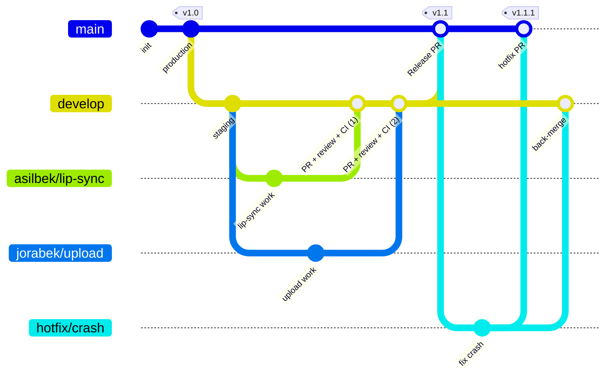

# Contributing to TH-Labs

## Branches

There are exactly two long-lived branches:

| Branch    | What it is | Who writes to it |
|-----------|------------|------------------|
| `main`    | Production. Every release on it is tagged `vX.Y.Z`. | Release PRs from `develop`, and `hotfix/*` PRs |
| `develop` | Staging. All feature work lands here first. | Feature PRs |

Everything else is short-lived and is deleted automatically when its PR merges:

| Pattern              | Example              | Branches from | Merges into |
|----------------------|----------------------|---------------|-------------|
| `<developer>/<task>` | `asilbek/lip-sync`   | `develop`     | `develop` |
| `hotfix/<task>`      | `hotfix/crash`       | `main`        | `main`, then `develop` |

A developer can instead work on one personal branch named after themselves
(e.g. `asilbek`), branched from and merged into `develop` like any other. Pick
one style per person: Git can't have `asilbek` and `asilbek/lip-sync` at the
same time, because a branch name is stored as a file path.

GitHub deletes the personal branch on merge too. Start the next piece of work
fresh from `develop`:

```bash
git switch asilbek
git fetch origin
git reset --hard origin/develop   # only once your last PR is merged
git push -u origin asilbek
```



## Rules

These are conventions, not settings. The repository is private on the free
plan, where GitHub doesn't enforce branch protection, so everyone keeps to them:

- Never push directly to `main` or `develop`. Everything goes through a PR.
- Every PR needs **1 approval** from someone other than the author, and **green CI**.
- Never `git push --force` to `main` or `develop`.
- Never delete `main` or `develop`.

CI (`.github/workflows/ci.yml`) runs lint, tests, type-check and build for
`api/`, `frontend/` and `backend/` on every PR into `develop` or `main`.

## Versioning

Tags follow `vMAJOR.MINOR.PATCH`.

- **PATCH** (`v1.1.1`): only `hotfix/*` releases.
- **MINOR** (`v1.2.0`): every Release PR from `develop`, even one that only has fixes.
- **MAJOR** (`v2.0.0`): a breaking change for callers of the account API or the
  pipeline API, such as a removed endpoint or a changed response shape.

## Starting a feature

```bash
git switch develop
git pull --ff-only
git switch -c asilbek/lip-sync
# ...work, commit...
git push -u origin asilbek/lip-sync
```

Keep the branch current with `develop` while you work:

```bash
git fetch origin
git rebase origin/develop          # rewrites only your own branch
git push --force-with-lease        # fine on your own branch, never on main/develop
```

## Opening a PR

```bash
gh pr create --base develop --fill
```

Fill in the template, get one approval and green CI, then merge on GitHub. The
branch is deleted on GitHub automatically. Clean up locally:

```bash
git switch develop
git pull --ff-only
git branch -d asilbek/lip-sync
git fetch --prune
```

## Releasing (develop → main)

```bash
gh pr create --base main --head develop --title "Release v1.1.0" --fill
```

After the Release PR is approved and merged, tag the merge commit on `main`:

```bash
git switch main
git pull --ff-only
git tag -a v1.1.0 -m "v1.1.0"
git push origin v1.1.0
gh release create v1.1.0 --verify-tag --generate-notes
```

## Hotfixing production

```bash
git switch main
git pull --ff-only
git switch -c hotfix/crash
# ...fix, commit...
git push -u origin hotfix/crash
gh pr create --base main --title "Hotfix: crash" --fill
```

After it merges, tag the patch release and bring the fix back into `develop`:

```bash
git switch main
git pull --ff-only
git tag -a v1.1.1 -m "v1.1.1"
git push origin v1.1.1
gh release create v1.1.1 --verify-tag --generate-notes

git switch develop
git pull --ff-only
git switch -c asilbek/backmerge-v1.1.1
git merge main
git push -u origin asilbek/backmerge-v1.1.1
gh pr create --base develop --title "Back-merge v1.1.1 into develop" --fill
```

The back-merge goes through a PR like everything else. If `main` and `develop`
conflict, resolve the conflict on that branch, not on `develop`.

## Rolling back

Production runs the API image named by `API_IMAGE` in
`deploy/server/docker-compose.yml`, which defaults to `:latest`. Every image is
also pushed with the full commit SHA, so rolling back means pointing
`API_IMAGE` at the image the previous release was running.

An image is only built when `api/` (or its workflow) changes, so the release
tag's own commit often has no image. Use the last commit at that tag that did
build one:

```bash
git log -1 --format=%H v1.0.0 -- api .github/workflows/api-image.yml
```

On the server:

```bash
cd /srv/th-labs
API_IMAGE=ghcr.io/asilbekali/th-labs-full/api:sha-<that-commit> docker compose up -d api
```

To undo the rollback, run `docker compose up -d api` without `API_IMAGE`, which
goes back to `:latest`.

There's no archive branch to restore from. The version tag *is* the record of
what was in production. The `archive/*` tags only keep the tips of branches
deleted in the November 2026 cleanup.
