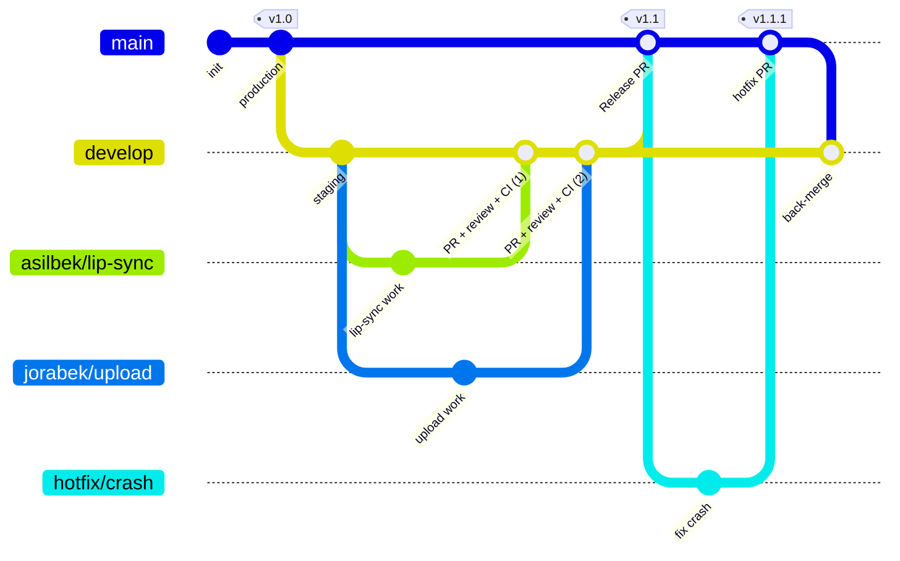

# Contributing to TH-Labs

## Branches

There are exactly two long-lived branches:

| Branch    | What it is | Who writes to it |
|-----------|------------|------------------|
| `main`    | Production. Every release on it is tagged `vX.Y.Z`. | Release PRs (`release/*`, cut from `develop`), and `hotfix/*` PRs |
| `develop` | Staging. All feature work lands here first. | Feature PRs, and `main` back-merges after a hotfix |

Both are permanent. A GitHub ruleset ("Keep main and develop") refuses to
delete or force-push them, for everyone, including GitHub's own auto-delete.

Everything else is short-lived and is deleted automatically when its PR merges:

| Pattern              | Example              | Branches from | Merges into |
|----------------------|----------------------|---------------|-------------|
| `<developer>/<task>` | `asilbek/lip-sync`   | `develop`     | `develop` |
| `release/vX.Y.0`     | `release/v1.1.0`     | `develop`     | `main` |
| `hotfix/<task>`      | `hotfix/crash`       | `main`        | `main`, then `main` → `develop` |

Always name a branch `<you>/<task>`, never just `<you>`. Git can't have
`asilbek` and `asilbek/lip-sync` at the same time, because a branch name is
stored as a file path.



The diagram draws the Release PR straight from `develop`. In practice it comes
from a `release/vX.Y.0` branch holding the same commits; see
[Releasing](#releasing-develop--main) for why.

## Rules

- Never push directly to `main` or `develop`. Everything goes through a PR.
- Every PR needs **1 approval** from another developer and **green CI**.
- **No self-merge.** The reviewer, not the author, presses Merge.
- PRs into `main` come only from `release/*` or `hotfix/*`. The only PR into
  `develop` from `main` is a back-merge after a hotfix.
- Release PRs come from a `release/vX.Y.0` branch, not from `develop` itself,
  so `develop` can keep taking features while a release is reviewed.
- Never `git push --force` to `main` or `develop`, and never delete them.
  GitHub refuses both.
- **Only Asilbek creates release tags** (`v*`) and GitHub releases.

CI (`.github/workflows/ci.yml`) runs lint, tests, type-check and build for
`api/`, `frontend/` and `backend/` on every PR into `develop` or `main`. PRs
that only touch Markdown or `docs/` skip it.

## What protects main and develop

The repository is public, so GitHub's free plan allows rulesets. One ruleset,
"Keep main and develop", blocks deleting and force-pushing both branches. It
doesn't require PRs, approvals or green CI, so three more things cover that:

1. **A local pre-push hook** (`.githooks/pre-push`). It refuses any push that
   updates, force-pushes or deletes `main` or `develop`, and tells you to open a
   PR. `npm install` at the repo root switches it on. It runs on your own
   computer and `--no-verify` skips it, so it's a safety net against mistakes,
   not a lock.
2. **A server-side alert** (`.github/workflows/branch-guard.yml`). Every push to
   `main` or `develop` is checked against GitHub's record of merged PRs. A
   commit that didn't come from one fails the run and opens an issue titled
   "Direct push to <branch> without PR" that mentions the pusher. A `v*` tag
   pushed by anyone but Asilbek opens an issue too. It never reverts anything:
   it makes the push visible so the team can deal with it.
3. **Team rules** (above, and the checklist in every PR). One approval, green
   CI, no self-merge, the right base branch. These are kept by agreement.

## First-time setup

```bash
git clone https://github.com/asilbekali/TH-Labs-full.git
cd TH-Labs-full
npm install        # at the repo root: turns on the pre-push hook
```

The root `package.json` has no dependencies. Its `prepare` script only runs
`git config core.hooksPath .githooks`. Each app still installs its own
dependencies in `api/`, `frontend/` and `backend/`, as the README describes.

## Versioning

Tags follow `vMAJOR.MINOR.PATCH`.

- **PATCH** (`v1.1.1`): only `hotfix/*` releases.
- **MINOR** (`v1.2.0`): every release from `develop`, even one that only has fixes.
- **MAJOR** (`v2.0.0`): a breaking change for callers of the account API or the
  pipeline API, such as a removed endpoint or a changed response shape, or a
  change in what the product is mainly for. v2 is the move to real-time dubbing
  as the main product.
- All apps share one version, so the backend, api, frontend and extension stay
  in step.
- The `/v1` route prefix is the API's own contract version, separate from the
  product version. It changes only when the routes break.

## Starting a feature

```bash
git switch develop
git pull --ff-only
git switch -c asilbek/lip-sync
# ...work, commit...
git push -u origin asilbek/lip-sync
```

Keep the branch current with `develop` while you work:

```bash
git fetch origin
git rebase origin/develop          # rewrites only your own branch
git push --force-with-lease        # fine on your own branch, never on main/develop
```

## Opening a PR

```bash
gh pr create --base develop --fill
```

Fill in the template and its checklist, then ask a teammate to review. Once it
has their approval and green CI, the reviewer merges it on GitHub. The branch
is deleted on GitHub automatically. Clean up locally:

```bash
git switch develop
git pull --ff-only
git branch -d asilbek/lip-sync
git fetch --prune
```

## Releasing (develop → main)

Asilbek only. Cut a release branch from `develop` and open the Release PR from
it. It freezes exactly what `develop` holds at that moment, so features merged
while the release is reviewed don't sneak into it. GitHub deletes the release
branch on merge, and `develop` stays:

```bash
git switch develop
git pull --ff-only
git switch -c release/v1.1.0
git push -u origin release/v1.1.0
gh pr create --base main --head release/v1.1.0 --title "Release v1.1.0" --fill
```

Anything merged into `develop` after the cut waits for the next release.

After the Release PR is approved and merged, tag the merge commit on `main`:

```bash
git switch main
git pull --ff-only
git tag -a v1.1.0 -m "v1.1.0"
git push origin v1.1.0
gh release create v1.1.0 --verify-tag --generate-notes
```

## Hotfixing production

```bash
git switch main
git pull --ff-only
git switch -c hotfix/crash
# ...fix, commit...
git push -u origin hotfix/crash
gh pr create --base main --title "Hotfix: crash" --fill
```

After it merges, Asilbek tags the patch release:

```bash
git switch main
git pull --ff-only
git tag -a v1.1.1 -m "v1.1.1"
git push origin v1.1.1
gh release create v1.1.1 --verify-tag --generate-notes
```

The same day, bring the fix back into `develop` with a PR from `main`. GitHub
never deletes the default branch, so `main` is safe as a PR source:

```bash
gh pr create --base develop --head main --title "Back-merge v1.1.1 into develop" --fill
```

If `main` and `develop` conflict, resolve it on a branch instead, never on
`develop` itself:

```bash
git switch develop
git pull --ff-only
git switch -c asilbek/backmerge-v1.1.1
git merge origin/main              # resolve the conflicts, commit
git push -u origin asilbek/backmerge-v1.1.1
gh pr create --base develop --title "Back-merge v1.1.1 into develop" --fill
```

## Rolling back

Production runs the API image named by `API_IMAGE` in
`deploy/server/docker-compose.yml`, which defaults to `:latest`. Every image is
also pushed with the full commit SHA, so rolling back means pointing
`API_IMAGE` at the image the previous release was running.

An image is only built when `api/` (or its workflow) changes, so the release
tag's own commit often has no image. Use the last commit at that tag that did
build one:

```bash
git log -1 --format=%H v1.0.0 -- api .github/workflows/api-image.yml
```

On the server:

```bash
cd /srv/th-labs
API_IMAGE=ghcr.io/asilbekali/th-labs-full/api:sha-<that-commit> docker compose up -d api
```

To undo the rollback, run `docker compose up -d api` without `API_IMAGE`, which
goes back to `:latest`.

There's no archive branch to restore from. The version tag *is* the record of
what was in production. The `archive/*` tags only keep the tips of branches
deleted in the November 2026 cleanup.
