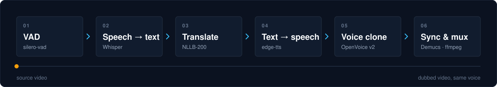
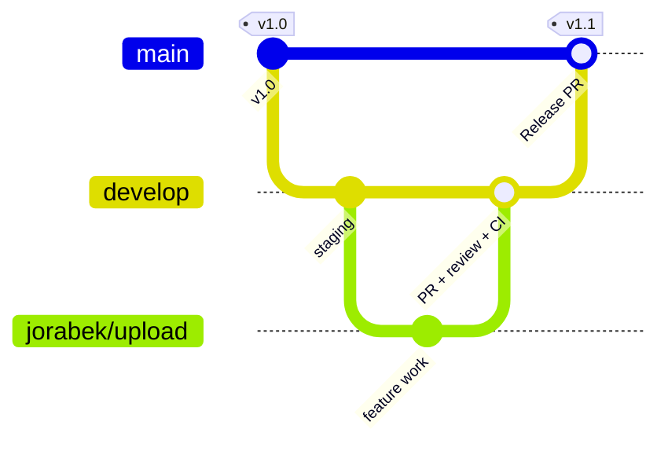

<div align="center">



<br/>


**[Live site](https://th-labs.uz)** · **[Architecture](docs/ARCHITECTURE.md)** · **[Pipeline](docs/PIPELINE.md)** · **[Contributing](CONTRIBUTING.md)**

</div>

---

## What is TH-Labs?

TH-Labs dubs **live speech in real time**. Calls, meetings and livestreams
reach you in your own language as people talk, through the Studio's Realtime
screen or the Chrome extension. Version 2 makes real-time dubbing the main
product.

Uploaded videos still work too. TH-Labs translates a video into **30+
languages** and keeps **the speaker's own voice** in the dub, with the original
music and effects kept.

It implements the cascaded **ASR → NMT → TTS → voice clone → sync** pipeline
from the RSEF 2026 paper *"An Automatic AI Dubbing System for Multilingual
Video Translation with Voice Preservation"* (Isoqov Jo'rabek & Asilbek
Abdug'afforov, New Uzbekistan University).



---

## What's in this repo

| Folder | What it is | Stack | Runs on |
|---|---|---|---|
| [`frontend/`](frontend) | The Studio web app: real-time dubbing, video dubbing, text to speech, account, plans | React · Vite · TypeScript · Tailwind | Modal (served by the backend) |
| [`extension/`](extension) | The Chrome extension: real-time dubbing for any tab (calls, meetings, streams) | TypeScript · Vite · Manifest V3 | Chrome |
| [`backend/`](backend) | The dubbing pipeline: jobs, live progress, models | FastAPI · Python | Modal, L4 GPU |
| [`api/`](api) | The account API: users, sign-in, credits, payments, admin | NestJS · Prisma · PostgreSQL | VPS, Docker |
| [`deploy/`](deploy) | Server compose, Caddy, Modal and Docker configs | | |
| [`docs/`](docs) | Architecture, pipeline and admin docs | | |
| [`promo/`](promo) | Scripts that render the promo video | Python | your laptop |

The Studio has **no user database of its own**. It trusts tokens minted by
`api/`. [docs/ARCHITECTURE.md](docs/ARCHITECTURE.md) explains how the pieces
talk to each other.

---

## Quick start

Choose how much of the stack you want to run on your machine. Each level adds
to the one before it.

### Level 1: just the UI (about 2 minutes)

Most frontend work only needs this. The dev server sends API calls to the
**deployed** account API and pipeline, so there's nothing else to set up.

```bash
git clone https://github.com/asilbekali/TH-Labs-full.git
cd TH-Labs-full/frontend
npm install
npm run dev            # → http://localhost:5173
```

### Level 2: + the account API locally

Use this for work on auth, credits, payments or admin. Docker runs the API
together with its own PostgreSQL database.

```bash
cp .env.example .env   # in the repo root; set POSTGRES_PASSWORD and the JWT secrets
docker compose up --build                            # → http://localhost:3000/v1
# in another terminal:
cd frontend && ACCOUNT_API_PROXY=http://localhost:3000 npm run dev
```

Swagger docs are served at `http://localhost:3000/docs`.

### Level 3: + the dubbing pipeline locally

Use this for work on the pipeline itself. The core install is light. Every
model is optional, and each stage falls back to a labelled *simulation*
when its model isn't installed.

```bash
cd backend
python -m pip install -r requirements.txt
python run.py                                        # → http://localhost:8000
# in another terminal:
cd frontend && DUB_API_PROXY=http://localhost:8000 npm run dev
```

To switch on real Whisper, NLLB, voice cloning and the other models, see
[docs/PIPELINE.md](docs/PIPELINE.md).

<details>
<summary><b>Prerequisites</b></summary>

| Tool | Version | Needed for |
|---|---|---|
| Node.js | 22 (what CI and the Docker image use) | `frontend/`, `api/` |
| Yarn | 1.x | `api/` (it has a `yarn.lock`) |
| Python | 3.11 – 3.13 | `backend/` |
| Docker | any recent | Level 2 |
| ffmpeg | on `PATH` | `backend/` with real models |

</details>

---

## Everyday commands

| | `frontend/` (npm) | `api/` (yarn) | `backend/` (python) |
|---|---|---|---|
| **Run** | `npm run dev` | `yarn start:dev` | `python run.py` |
| **Lint** | `npm run lint` | `yarn lint` (auto-fixes) | — |
| **Test** | — | `yarn test` | `python -m pytest tests` |
| **Build** | `npm run build` | `yarn build` | — |

CI runs these on every pull request ([`.github/workflows/ci.yml`](.github/workflows/ci.yml)).
Run them locally first so your PR comes up green.

---

## How we work with Git



| Branch | Purpose | Rule |
|---|---|---|
| `main` | **Production.** Every release on it is tagged `vX.Y.Z`. | Changes only through a Release PR or a `hotfix/*` PR |
| `develop` | **Staging.** Where all work lands first. | Changes only through PRs |
| `<you>/<task>`, e.g. `jorabek/upload` | One task's work | Branch from `develop`, PR back into `develop` |
| `<you>`, e.g. `asilbek` | A personal work branch (instead of `<you>/<task>`, not as well as) | Same as above; see [CONTRIBUTING.md](CONTRIBUTING.md#branches) |
| `hotfix/<task>` | Urgent production fix | Branch from `main`, PR into `main`, then into `develop` |

Your first contribution:

```bash
git switch develop && git pull --ff-only
git switch -c yourname/short-task-name
# ...make changes, commit...
git push -u origin yourname/short-task-name
gh pr create --base develop --fill
```

Releases, hotfixes and rollbacks are covered step by step in **[CONTRIBUTING.md](CONTRIBUTING.md)**.

---

## Project rules

1. **Never push directly to `main` or `develop`.** Every change goes through a pull request.
2. **One approval and green CI** before anything is merged. You can't approve your own PR.
3. **Never `git push --force`** to `main` or `develop`. On your own branch, use `--force-with-lease`.
4. **Keep each PR to one task.** Small PRs get reviewed quickly; big ones sit for days.
5. **Never commit secrets.** `.env` files stay local. Add new variables to the matching `.env.example` with a comment.
6. **Fill in the PR template:** what changed, why, how you tested it, and screenshots for any UI change.
7. **Database changes go through Prisma migrations** in `api/prisma/migrations`. Never edit the production database by hand.
8. **Be honest in the UI.** If a stage ran as a simulation, the Studio says so. Keep it that way.
9. **Voice cloning needs consent.** Only re-voice people who agreed to it, and label AI-dubbed output.

---

## Documentation

| Doc | Read it when |
|---|---|
| [docs/ARCHITECTURE.md](docs/ARCHITECTURE.md) | You need the big picture: hosts, sign-in handoff, credits, payments |
| [docs/PIPELINE.md](docs/PIPELINE.md) | You work on the dubbing stages, models, or the pipeline API |
| [docs/ADMIN_PANEL_BRIEF.md](docs/ADMIN_PANEL_BRIEF.md) | You work on the admin panel |
| [deploy/server/README.md](deploy/server/README.md) | You deploy or operate the VPS |
| [CONTRIBUTING.md](CONTRIBUTING.md) | You open a PR, cut a release, ship a hotfix, or roll back |

---

## Results (RSEF 2026 study)

| WER | BLEU | COMET | MOS | Speaker similarity | Sync offset |
|---|---|---|---|---|---|
| 11% | 38.7 | 0.86 | 3.5 / 5 | 87.3% | 41 ms |

The 41 ms sync offset is within the ITU-R BT.1359-1 imperceptibility threshold.

---

<div align="center">
<sub>Built at New Uzbekistan University · RSEF 2026 · For research and authorized use only</sub>
</div>
